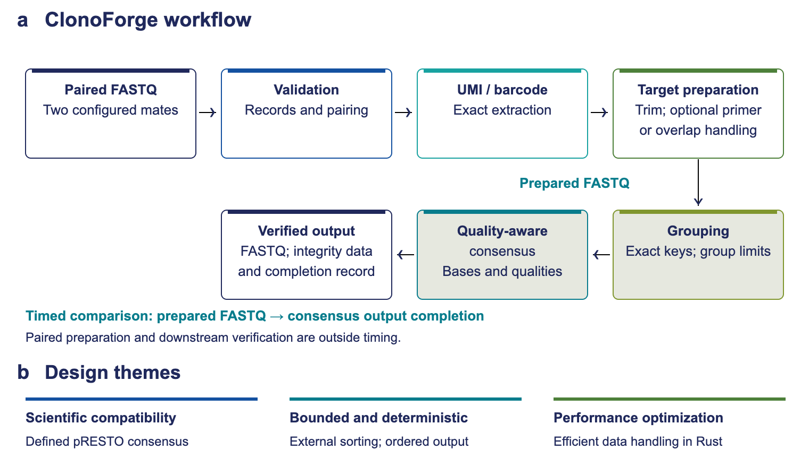
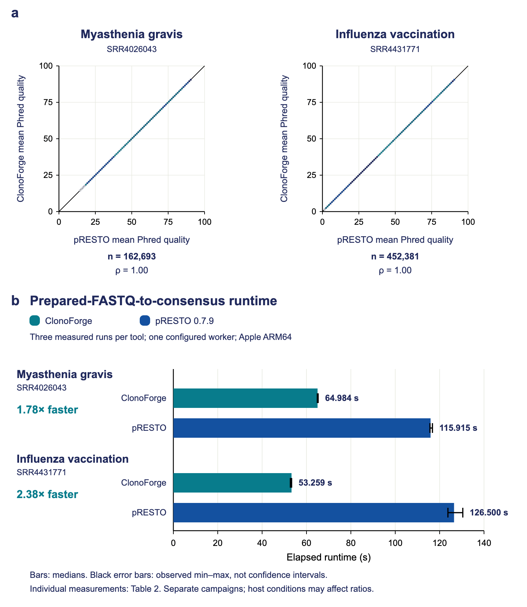

# ClonoForge

ClonoForge is a Rust tool for deterministic, bounded FASTQ preprocessing and exact-barcode consensus generation.

**Version 1.0.0** · [Quick Start](docs/QUICK_START.md) · [User manual](docs/USER_MANUAL.md) · [Manuscript](docs/ClonoForge-Manuscript.pdf) · [Troubleshooting](docs/TROUBLESHOOTING.md)

 

## Workflow



ClonoForge checks paired reads, extracts exact barcode keys, prepares target sequences, and builds quality-aware consensus from eligible groups. It also accepts prepared, barcode-annotated FASTQ for consensus.

## Validation and performance



Under the tested settings, consensus FASTQ outputs were byte-identical to pRESTO 0.7.9 for both evaluated studies. ClonoForge was **1.78× faster** for the myasthenia gravis dataset and **2.38× faster** for the influenza-vaccination dataset. These ratios compare median times from separate campaigns and cover only the prepared-FASTQ-to-consensus stage on the tested Apple ARM64 system. They are not whole-workflow speedups or evidence of broad biological equivalence. See the [manuscript](docs/ClonoForge-Manuscript.pdf) for methods and limitations.

## Quick Start

Install Rust and Cargo, then build from the source folder:

```sh
cargo build --release --locked
./target/release/clonoforge --help
```

Follow the [Quick Start](docs/QUICK_START.md) for a complete synthetic example and output verification. No prebuilt executable is distributed.

## Key features

- Paired-read preprocessing and exact-barcode grouping.
- Quality-aware consensus and optional ungapped overlap assembly.
- Bounded processing, completion receipts and output hashes.

## Inputs and outputs

Input is synchronized paired FASTQ, plain or gzip, or a prepared barcode-annotated FASTQ for consensus. A paired run produces qualified reads, completion receipts and, when produced, a consensus FASTQ. See the [manual](docs/USER_MANUAL.md) for input contracts and output details.

## Documentation

[Quick Start](docs/QUICK_START.md) · [User manual](docs/USER_MANUAL.md) · [Manuscript](docs/ClonoForge-Manuscript.pdf) · [Troubleshooting](docs/TROUBLESHOOTING.md) · [Receipt schemas](schemas/)

## Limitations

The standard maximum is **50 reads per group**; separately compiled 100, 250 and 500 profiles are opt-in experimental methods with finite qualification. ClonoForge does not correct barcode errors or perform a complete repertoire analysis. Memory admission is a model, not a hard operating-system limit. Qualification and performance results apply to the tested settings and system.

## Citation

Cite ClonoForge 1.0.0 and the exact commit used; see [CITATION.cff](CITATION.cff). Cite pRESTO and the relevant datasets where applicable.

## License

Original ClonoForge code is available under the [MIT](LICENSE-MIT) or [Apache-2.0](LICENSE-APACHE) license. Third-party materials retain their own terms; see [notices](THIRD-PARTY-NOTICES.md).
